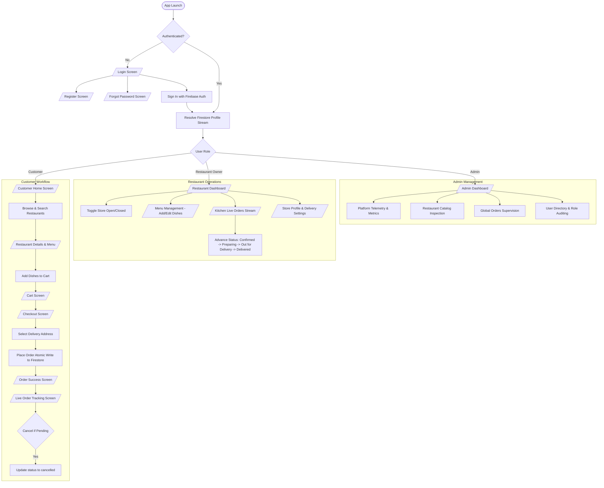

# 🍔 FoodExpress — Full-Stack Food Delivery & Restaurant Management App

[](https://flutter.dev/)
[](https://dart.dev/)
[](https://firebase.google.com/)
[](https://riverpod.dev/)
[](https://flutter.dev/)
[](https://flutter.dev/)

**FoodExpress** is a multi-role food ordering, kitchen management, and platform administration mobile application built with **Flutter**, **Dart**, **Riverpod 2.x**, and **Firebase** (Authentication, Cloud Firestore, and Firebase Cloud Messaging). 

Designed following **Feature-First Clean Architecture**, the codebase strictly separates presentation, domain entities, and data persistence via the **Repository Pattern**. It provides real-time Firestore document snapshot streaming, role-based access control (RBAC), declarative routing, and comprehensive automated test coverage with **416 passing tests** across 48 suites.

## ✨ Key Features (Verified Implementation)

### 🔐 1. Authentication & Role-Based Access Control (RBAC)
* **Firebase Authentication**: Email and password user registration, login, logout, and password reset flows.
* **Session Persistence**: Automatic session restoration via `authStateChanges` stream.
* **Asynchronous Profile Resolution**: Router defers role-based navigation decisions until the Firestore profile stream emits, eliminating race conditions and redirect flickers.
* **Declarative Route Guards**: Protected portals guarded by role:
  - **Customers** land on `/home` and cannot access restaurant management or admin routes.
  - **Restaurant Owners** automatically land on `/restaurant/dashboard` and are redirected away from customer landing routes.
  - **Platform Admins** automatically land on `/admin/dashboard` and are redirected away from `/home`.
  - **Unauthenticated Users** attempting to access protected routes (`/cart`, `/checkout`, `/orders`, `/profile`, `/restaurant/*`, `/admin/*`) are routed to `/login`.

### 🛍️ 2. Customer Experience
* **Restaurant Discovery**: Browsing restaurants with cuisine tags, delivery times, estimated fees, ratings, and open/closed operational indicators.
* **Instant Keyword Search & Filtering**: Real-time filtering by restaurant name, cuisine, and food item categories.
* **Categorized Menu Inspection**: Categorized menu display with dish descriptions, pricing, and live availability toggles.
* **In-Memory Cart Management**: Single-restaurant cart enforcement, dynamic item quantity increments/decrements, live subtotal computation, and persistent navigation bar badge counts.
* **Customer Favorites**: Instant bookmarking of favorite restaurants with user-scoped persistence.
* **Address Book**: Full CRUD operations for customer delivery addresses (Home, Work, Other) with default selection and checkout address switching.
* **Checkout Flow**: Comprehensive review of selected address, itemized dish summary, delivery notes, and billing breakdown.
* **Real-Time Order Tracking**: Live tracking screen streaming Firestore document snapshots via `watchOrderById` with a 5-step visual progression timeline (`pending` → `confirmed` → `preparing` → `outForDelivery` → `delivered` / `cancelled`).
* **Customer Order Cancellation**: Allows customers to cancel orders while in `pending` status, with Firestore security rules preventing tampering with order amounts or cancellation of processed orders.
* **In-App Notification Center**: User-scoped notification center displaying order status updates and read/unread state management.

### 🍳 3. Restaurant Owner Portal
* **Operational Dashboard**: Real-time metrics tracking pending, confirmed, preparing, out-for-delivery, and delivered orders alongside calculated gross revenue.
* **Store Open / Closed Switch**: Live toggle updating restaurant operational status in Cloud Firestore.
* **Kitchen Order Queue**: Live order stream allowing kitchen staff to advance order lifecycle statuses sequentially.
* **Menu CRUD Management**: Full modal dialog for adding, editing, and deleting dishes with custom pricing, categories, and stock availability toggles.
* **Store Settings Editor**: Direct editing of restaurant metadata (name, description, cuisine, address, delivery fee, delivery time).
* **Missing Store Safety**: Displays a `"Store Not Configured"` state when a linked restaurant document is missing, avoiding misleading fallback values.

### 🛡️ 4. System Administration & Platform Management
* **Admin Dashboard**: Centralized management portal featuring four dedicated tabs:
  - **Platform Telemetry**: Aggregated order volume, revenue metrics, and user counts.
  - **Restaurant Catalog**: Global inspection of all registered restaurant stores.
  - **Global Orders**: Platform-wide order oversight across all restaurants.
  - **User Directory**: Directory of registered users and assigned roles.

---

## 🛠️ Technology Stack

| Layer | Technology | Package / Version | Purpose |
| :--- | :--- | :--- | :--- |
| **Client Framework** | Flutter | SDK `^3.11.1` (Dart 3.x) | Cross-platform UI development (Android, iOS, Web, Desktop) |
| **State Management** | Flutter Riverpod | `flutter_riverpod: ^2.6.1` | Reactive state management, dependency injection, and family providers |
| **Navigation & Routing** | GoRouter | `go_router: ^14.8.1` | Declarative routing, deep linking, and RBAC redirect guards |
| **Authentication** | Firebase Auth | `firebase_auth: ^6.6.1` | User identity, email/password credentials, and session streams |
| **Cloud Database** | Cloud Firestore | `cloud_firestore: ^6.8.0` | Real-time document streaming, user subcollections, and orders |
| **Push Notifications** | Firebase Messaging | `firebase_messaging: ^16.6.0` | Device FCM token synchronization and push messaging client hooks |
| **Core Firebase** | Firebase Core | `firebase_core: ^4.14.0` | Firebase project runtime initialization |
| **Design System** | Material 3 & Google Fonts | `google_fonts: ^6.2.1` | Custom color palette, Poppins typography scale, and reusable components |
| **Code Quality** | Flutter Lints | `flutter_lints: ^6.0.0` | Static analysis and strict linting rules |
| **Testing** | Flutter Test | `flutter_test` (Flutter SDK) | Unit, widget, provider, and route navigation integration tests |

---

## 🏛️ Architecture & Project Structure

The project follows a **Feature-First Architecture** supported by a shared `core/` module. Each feature encapsulates its own data models, repositories (with Firestore and in-memory mock implementations), presentation screens, widgets, and Riverpod controllers.

```
lib/
├── core/
│   ├── constants/            # Design tokens: AppColors, AppTypography, AppDimensions
│   ├── mock/                 # In-memory mock data for offline testing & widget previews
│   ├── routing/              # AppRouter (GoRouter setup, RBAC redirect guards, RefreshNotifier)
│   ├── services/             # Core application services
│   ├── theme/                # Material 3 theme configuration (AppTheme.lightTheme)
│   └── widgets/              # Reusable UI components (AppButton, AppTextField, AppCard, etc.)
├── features/
│   ├── address/              # Address models, AddressRepository, AddressListScreen, AddEditAddressScreen
│   ├── admin/                # Admin models, FirestoreAdminRepository, AdminDashboardScreen & tabs
│   ├── auth/                 # UserModel, AuthRepository, LoginScreen, RegisterScreen, ForgotPasswordScreen
│   ├── cart/                 # CartItemModel, CartController, CartScreen
│   ├── checkout/             # CheckoutScreen, OrderSuccessScreen, CheckoutController
│   ├── favorites/            # FavoriteModel, FavoriteRepository, FavoritesScreen
│   ├── home/                 # HomeScreen, HomeAppBar, CategoryChips, RestaurantCard
│   ├── notifications/        # NotificationModel, NotificationRepository, NotificationScreen, NotificationEventBridge
│   ├── order/                # OrderModel, OrderRepository, OrderHistoryScreen, OrderTrackingScreen, Timeline
│   ├── profile/              # UserRepository, ProfileScreen, EditProfileSheet, UserController
│   └── restaurant/           # RestaurantModel, FoodItemModel, RestaurantDashboardScreen, MenuScreen, SettingsScreen
├── firebase_options.dart     # Generated FlutterFire configuration
└── main.dart                 # Application entry point with ProviderScope initialization
```

---

## 🔄 Application Workflow



---

## 🔒 Firebase Integration & Security Architecture

### 1. Firestore Data Collections
* **`users/{userId}`**: Stores user domain metadata (`name`, `email`, `role`, `restaurantId`, `phone`, `address`, `fcmToken`, `createdAt`).
  - **`users/{userId}/addresses/{addressId}`**: Customer saved delivery locations.
  - **`users/{userId}/favorites/{favoriteId}`**: Customer bookmarked restaurant IDs.
  - **`users/{userId}/notifications/{notificationId}`**: User-scoped push/in-app notification documents.
* **`restaurants/{restaurantId}`**: Public restaurant discovery metadata (`name`, `cuisine`, `rating`, `isOpen`, `deliveryFee`, `deliveryTime`).
  - **`restaurants/{restaurantId}/menu_items/{itemId}`**: Dish entries with pricing, description, and availability.
* **`orders/{orderId}`**: Customer orders containing customer UID, fulfilling restaurant ID, itemized dish payloads, totals, and timestamps.

### 2. Firestore Security Rules Summary
The application includes a strictly audited [`firestore.rules`](file:///c:/Users/PMLS/Desktop/foodexpressdelivery/firestore.rules) file enforcing the principle of least privilege:
* **Role Elevation Defense**: Users cannot mutate their own `role` or `restaurantId` fields.
* **Subcollection Isolation**: Notifications and addresses can only be read, modified, or deleted by their verified owner or an administrator.
* **Notification Tampering Prevention**: Users updating notification documents are restricted to modifying `isRead`.
* **Order Creation Constraints**: Requires authenticated user identity binding (`userId == auth.uid`), initial `status == 'pending'`, non-negative totals (`subtotal`, `deliveryFee`, `total`), and a non-empty `items` list.
* **Order Cancellation Rules**: Customers can only cancel their own orders, only while the database status is `pending`, and can only mutate `status` (to `cancelled`) and `updatedAt`.
* **Restaurant Boundary Enforcement**: Restaurant owners can only update orders and menu items matching their assigned `restaurantId`.

---

## 🚀 Installation and Setup

### Prerequisites
* [Flutter SDK](https://docs.flutter.dev/get-started/install) (`^3.11.1` or later)
* [Dart SDK](https://dart.dev/get-dart)
* [Android Studio](https://developer.android.com/studio) / Xcode (for mobile emulators or physical device builds)
* [Firebase CLI](https://firebase.google.com/docs/cli) (optional, for deploying security rules and indexes)

### 1. Clone the Repository
```bash
git clone https://github.com/your-username/foodexpressdelivery.git
cd foodexpressdelivery
```

### 2. Install Flutter Dependencies
```bash
flutter pub get
```

### 3. Firebase Configuration
To connect the app to your own Firebase project:
1. Create a project in the [Firebase Console](https://console.firebase.google.com/).
2. Enable **Firebase Authentication** with the **Email/Password** sign-in provider.
3. Enable **Cloud Firestore** in production or test mode.
4. Run FlutterFire CLI to generate your `firebase_options.dart`:
   ```bash
   flutterfire configure
   ```
5. Deploy the provided Firestore Security Rules and Composite Indexes:
   ```bash
   firebase deploy --only firestore:rules,firestore:indexes
   ```

---

## 📱 Running the Application

### Run in Debug Mode
Connect an Android device, iOS simulator, or desktop browser, and execute:
```bash
flutter run
```

### Build Android Debug APK
```bash
flutter build apk --debug
```
The output APK is generated at:
`build/app/outputs/flutter-apk/app-debug.apk`

---

## 🧪 Testing and Code Quality

The project employs comprehensive automated test suites using `flutter_test`, leveraging Riverpod provider overrides to test domain logic and widgets in complete isolation without live backend dependencies.

### Run Static Analysis
```bash
flutter analyze
```
*Current result: `No issues found!` (0 errors, 0 warnings, 0 lints).*

### Run Automated Tests
```bash
flutter test
```
*Current result: **416 passing tests across 48 test suites** with 0 failures.*

### Test Suite Highlights
* **Auth & Routing Tests**: Role-based access control, router race-condition handling, stream loading state transitions, and unauthenticated redirects.
* **Order & Tracking Tests**: Timeline state rendering, order cancellation validation, invalid status transition rejection, and protected field immutability.
* **Restaurant Portal Tests**: Missing store state (`"Store Not Configured"`), error retry mechanisms, and open/closed switch toggling.
* **Cart & Checkout Tests**: Quantity increment/decrement math, single-restaurant enforcement, and atomic order placement.


## 📊 Project Status

* **Dart & Flutter Codebase**: Fully verified with **416 passing tests** and **0 analyzer issues**.
* **Android Build Pipeline**: Verified (`flutter build apk --debug` builds successfully).

---

## 🤝 Contributing

Contributions, bug reports, and feature proposals are welcome.
1. Fork the Project.
2. Create a Feature Branch (`git checkout -b feature/AmazingFeature`).
3. Commit your Changes (`git commit -m 'Add some AmazingFeature'`).
4. Ensure all tests pass (`flutter test && flutter analyze`).
5. Push to the Branch (`git push origin feature/AmazingFeature`).
6. Open a Pull Request.

---

## 📄 License

This repository does not currently have an explicit open-source license file attached. All rights are reserved by the repository owner.
